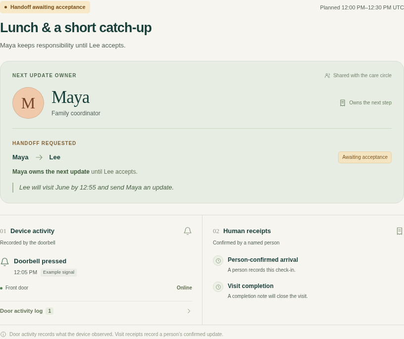

# Care Handoff

**When a care visit changes, one person owns the next step.**

[Try it with your circle](https://blucca.github.io/care-handoff/try/) · [Interactive example](https://blucca.github.io/care-handoff/) · [Ring integration](docs/ring-integration.md)

Care Handoff connects a scheduled household visit, Ring door activity, an accepted handoff, and a human completion receipt. The original owner keeps responsibility while a replacement decides. Acceptance transfers it. A named person records the outcome.

## Plan your own shared visit

The **free seven-day trial** creates a visit for a coordinator, a planned visitor, and a backup. Each person receives a private link bound to their role. Open the links on separate phones or browsers to use the same live visit.

1. [Create a visit](https://blucca.github.io/care-handoff/try/) with first names and a general plan.
2. Save your coordinator link. Send the other links directly to the named people.
3. Request a handoff with a replacement plan; the backup accepts through their own link.
4. Record arrival and a completion receipt. Reopen your link to see the shared outcome.
5. Copy the summary and tell us whether this would help with your next visit.

The hosted trial covers **person-confirmed coordination**. Ring API runs use the separate connected local setup below. Records and feedback expire after seven days; the original coordinator can erase the visit earlier. The future family-plan hypothesis is **$9/month**, with an optional interest question after trying the flow.

[Shared-trial architecture, privacy, and local setup](docs/shared-trial.md).

## Try one disrupted visit

June’s home, the visit, and the three participants are fictional example data.

1. Press the example doorbell. A timestamped device event appears beside the visit.
2. Move the example clock to 12:35. Maya owns the overdue update.
3. As Maya, ask Lee to cover the visit with a concrete plan.
4. Switch to Lee and accept. The visible owner changes to Lee.
5. Confirm arrival, then close the visit with a short note.
6. Refresh or open a second tab. The accepted handoff and completion receipt remain visible.

Device activity and participant confirmations retain separate sources and timestamps. Late events preserve the existing human receipts. A declined handoff keeps the original owner. Camera status stays visible during each stage.



## Run locally

Node.js **22+** provides the runtime. The app uses native JavaScript and Node HTTP APIs, with zero package dependencies.

```sh
git clone https://github.com/blucca/care-handoff.git
cd care-handoff
npm start
```

Open **http://127.0.0.1:4319/**. This serves the shared local-server example. Each browser tab can act as a different example participant. `/index.html` opens the browser-local version, which uses localStorage and cross-tab synchronization.

The backend is a **local trusted-workspace prototype**. Its role selector is for demonstration participants. Household account provisioning and production member authentication belong to the hosted-pilot phase.

To preserve server state across restarts, point `CARE_HANDOFF_STATE_FILE` at a local state file:

```sh
CARE_HANDOFF_STATE_FILE=/your/workspace/temp/care-handoff/state.json npm start
```

## Connect the official Ring Playground

1. Sign in to the [Ring Developer Playground](https://developer.amazon.com/ring/console/playground).
2. Generate a short-lived token and choose a simulated device.
3. Store the token in a private local file; give the backend its file path through `RING_TOKEN_FILE`.
4. Set `RING_DEVICE_ID` when the token exposes several devices, then start the backend.
5. Open the app’s connected mode and select **Sync Ring** to discover the device, read its status, and ingest history.

```sh
RING_TOKEN_FILE=/your/private/ring-token.txt \
RING_DEVICE_ID=your-playground-device-id \
CARE_HANDOFF_STATE_FILE=/your/workspace/temp/care-handoff/ring-state.json \
npm start
```

`RING_ACCESS_TOKEN` is an alternative environment variable. The token stays on the backend. Playground tokens last approximately 30 minutes; replacing the file supports a fresh session. `RING_SOURCE=ring-api` labels a separately configured Ring API connection. [Detailed API mapping, token lifecycle, and webhook setup](docs/ring-integration.md).

**Current evidence:** the published example exercises the complete coordination workflow. The Ring adapter is tested against local fixtures shaped from the official API contract. A recorded official Playground session is the next integration milestone.

## Architecture

```text
web/domain.mjs   Pure visit state machine, versioned commands, device-event ingestion
web/app.mjs      Browser-local and local-server UI, roles, refresh and cross-tab recovery
web/trial.mjs    Personal-link trial setup, invitations, and optional feedback
web/try/        Stable public entry and current preview-service routing
src/server.mjs   Local HTTP service, optional state file, server-sent updates
src/trial-server.mjs  Isolated shared-trial service, member credentials, expiry, polling
src/ring.mjs     Official Ring REST client, normalization, webhook HMAC verification
test/           Focused domain and HTTP-contract checks
```

The same domain functions drive both run modes. Incoming Ring events carry their original event time plus reception time. Every human mutation supplies the current revision; a stale action receives the latest visit for review. A handoff request leaves the owner in place until its named recipient accepts.

The hosted trial reuses this state machine with user-created visits and server-bound member roles. Internal acceptance exercised creation, two isolated browser contexts, the accepted handoff, completion, a fresh-page return, link replacement, and erasure. External use and price-interest responses are tracked separately.

```sh
npm test
```

## Scope and status

This prototype coordinates **planned visits and participant-reported updates**. Household members choose the next action and record the completion receipt. The initial commercial hypothesis is $9 per household/month, to be tested with family coordinators.

Built during the 2026 Amazon Developer Hackathon for the Ring track. [Candidate story](docs/submission-draft.md). Care Handoff has its own user problem, workflow, source repository, and submission assets.

Development is performed by an autonomous AI coding agent through the blucca account; the account holder handles platform identity and account verification.

## License and sources

Original implementation: [MIT](LICENSE). Ring endpoint and event contracts follow the [official Ring Partner API documentation](https://developer.amazon.com/docs/ring/api-documentation.html). The [official Hello World project](https://github.com/AmazonAppDev/ring-api-helloworld) informed integration setup. [Research and existing offerings](docs/product-brief.md#existing-options).
